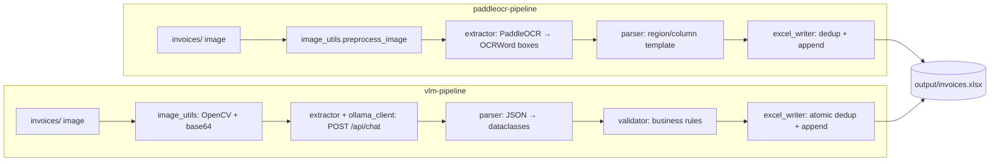

# Restaurant Receipt OCR

Two offline pipelines that turn photos of restaurant/café POS receipts into structured rows in an Excel workbook. Each pipeline takes a different approach to OCR:

| Directory | Approach | Status |
|---|---|---|
| [`paddleocr-pipeline/`](paddleocr-pipeline/) | **Traditional OCR + template parsing.** PaddleOCR detects and recognises text boxes, and a coordinate-based parser maps them to fields using fixed layout regions. | ✅ Working (validated by the author on Python 3.13 + PaddleOCR 3.x) |
| [`vlm-pipeline/`](vlm-pipeline/) | **Vision-language model.** The whole receipt image is sent to a local VLM through Ollama, which returns structured JSON directly. The output is validated before writing. | ⚠️ **Incomplete: the live model call does not work yet** (see [Limitations](#limitations)) |

## Problem Statement

Small restaurants and cafés often keep paper POS receipts with no export from the POS system. Re-typing orders, items and totals into a spreadsheet for bookkeeping is slow and error-prone. Both pipelines automate this. You drop receipt photos into a folder, and you get one Excel row per line item with invoice-level fields (number, date, time, table, cashier, totals) and duplicate protection.

## Comparison of the Two Implementations

| Aspect | `paddleocr-pipeline` (traditional) | `vlm-pipeline` (VLM) |
|---|---|---|
| OCR engine | `paddleocr` / `paddlepaddle` 3.x Python packages | `MedAIBase/PaddleOCR-VL:0.9b` served by **Ollama** over HTTP (`/api/chat`) |
| How fields are found | Pixel regions defined in `config.py` (header / items / totals bands, column fractions), plus keyword fallback and regex on isolated text | A single detailed prompt describing the Arabic POS layout. The model returns JSON |
| Layout assumption | One fixed receipt template. Regions must be recalibrated (with `--debug` overlays) for a new layout | One fixed Arabic template. The prompt must be rewritten for a new layout |
| Preprocessing | Resize, grayscale, CLAHE, denoise, deskew. PaddleOCR doc-orientation classifier | OpenCV rotate/deskew/denoise/contrast/resize, base64 encoding |
| Validation | Back-fills missing cell values (`total = qty × unit_price`) | Dedicated `validator.py`: date/time formats, non-negative totals, `subtotal − discount + vat ≈ grand_total` |
| Retries / failures | n/a | Up to `RETRY_ATTEMPTS` retries on bad JSON or low completeness. Failed images go to `failed/` |
| Concurrency | Sequential | `ThreadPoolExecutor` (`MAX_WORKERS`) with a lock-protected Excel writer |
| Duplicate detection | `Invoice No`, else hash of `Date + Time + Grand Total` | Same idea (`invoice_number`, else SHA-256 of `date|time|grand_total`), done atomically under a lock |
| Arabic digits / formats | Via `OCR_LANGUAGE` setting | Normalises Arabic-Indic digits and POS date/time formats in `parser.py` |
| Dependencies | paddlepaddle, paddleocr, opencv-python, numpy, pandas, openpyxl, watchdog | opencv-python, numpy, openpyxl, requests, Pillow, watchdog, tqdm + a local Ollama install |

## Architecture



In both pipelines `main.py` is a batch runner and `watcher.py` is a `watchdog` folder monitor that reuses the same processing function.

## Project Structure

```
restaurant-receipt-ocr/
├── paddleocr-pipeline/
│   ├── config.py          # paths, OCR settings, template regions
│   ├── image_utils.py     # preprocessing + debug overlays
│   ├── extractor.py       # PaddleOCR wrapper, orientation handling
│   ├── parser.py          # region-based template parser
│   ├── excel_writer.py    # Excel append + duplicate detection
│   ├── main.py            # batch CLI (--debug)
│   ├── watcher.py         # folder watcher
│   ├── samples/test_invoice.png   # synthetic sample receipt
│   ├── requirements.txt
│   └── README.md          # detailed design + calibration guide
├── vlm-pipeline/
│   ├── config.py          # settings (env-overridable) + logging
│   ├── ollama_client.py   # requests.Session wrapper for /api/chat
│   ├── extractor.py       # prompt, retries, JSON recovery
│   ├── parser.py          # normalisation → Invoice/Item
│   ├── validator.py       # format + totals checks
│   ├── excel_writer.py    # thread-safe Excel writer
│   ├── image_utils.py
│   ├── main.py            # threaded batch runner
│   ├── watcher.py
│   ├── notebook.ipynb             # exploration notebook (outputs cleared)
│   ├── pipeline_test_suite.ipynb  # component-by-component test notebook
│   ├── requirements.txt
│   └── README.md          # detailed design, config table, troubleshooting
├── .env.example           # optional overrides for vlm-pipeline
└── .gitignore
```

Runtime folders (`invoices/`, `processed/`, `failed/`, `output/`, `debug/`, `logs/`) are created automatically by each pipeline's `config.py` and are git-ignored.

## Installation

Each pipeline has its own dependencies. Install them in separate virtual environments.

### Traditional pipeline (PaddleOCR)

```bash
cd paddleocr-pipeline
python -m venv venv
venv\Scripts\activate            # Windows  (source venv/bin/activate on Linux/macOS)
pip install -r requirements.txt
```

The first run downloads the PaddleOCR detection/recognition/orientation models (a few hundred MB) into `~/.paddleocr`. This needs an internet connection once.

### VLM pipeline (Ollama)

```bash
cd vlm-pipeline
python -m venv venv
venv\Scripts\activate
pip install -r requirements.txt

# Install Ollama from https://ollama.com, then:
ollama pull MedAIBase/PaddleOCR-VL:0.9b
```

## Configuration

- **paddleocr-pipeline:** all settings (`OCR_LANGUAGE`, `OCR_DEVICE`, `MIN_OCR_CONFIDENCE`, region bands, column fractions) are constants in `paddleocr-pipeline/config.py`. No environment variables or secrets are required.
- **vlm-pipeline:** settings in `vlm-pipeline/config.py` can be overridden with environment variables (`OLLAMA_URL`, `MODEL_NAME`, `MAX_WORKERS`, `RETRY_ATTEMPTS`, `SAVE_DEBUG_ARTIFACTS`, …). See [`.env.example`](.env.example) and the configuration table in `vlm-pipeline/README.md`. No API keys are used; everything runs locally. Note that `config.py` reads these with `os.getenv` and does not load a `.env` file itself, so export the variables in your shell.

## Usage

```bash
# Traditional pipeline
cd paddleocr-pipeline
mkdir invoices                # created automatically on first run, too
copy samples\test_invoice.png invoices\   # or drop your own receipt photos into invoices/
python main.py                # process everything in invoices/
python main.py --debug        # also write annotated overlays to debug/
python watcher.py             # keep watching invoices/

# VLM pipeline
cd vlm-pipeline
python main.py                # threaded batch run with progress bar
python watcher.py
```

Output is written to `output/invoices.xlsx` (one row per item). Columns are `Invoice No | Date | Time | Table | Cashier | Item | Quantity | Unit Price | Item Total | Subtotal | VAT | Discount | Grand Total`, and the VLM pipeline adds an internal `Hash` column.

## Dataset

No receipt dataset is included. The real receipt photos used during development are private business records and are deliberately excluded from this repository. `paddleocr-pipeline/samples/test_invoice.png` is a synthetic receipt you can use to try the traditional pipeline.

## Model Details and Evaluation

- **Traditional:** pretrained PaddleOCR 3.x models (no training in this repo).
- **VLM:** `MedAIBase/PaddleOCR-VL:0.9b` via Ollama (no training in this repo).

No quantitative accuracy evaluation has been run on either pipeline, so no metrics are reported.

## Limitations

- ⚠️ **The VLM pipeline's live model call is not functional yet.** With the locally pulled `MedAIBase/PaddleOCR-VL:0.9b`, every image request fails with `500: "image input is not supported - hint: ... provide the mmproj"`. The Ollama manifest of that pull has no vision projector layer, and `ollama show` reports only the `completion` capability. The preprocessing, parsing, validation, duplicate detection, Excel writing, retries, logging and watcher were exercised directly, but **no end-to-end VLM extraction has succeeded**. `vlm-pipeline/README.md` → *Troubleshooting* lists the fixes to try (update Ollama, re-pull, use another vision-capable model via `MODEL_NAME`).
- Both pipelines target **one fixed POS receipt layout**. They are not general-purpose invoice understanding systems.
- `vlm-pipeline/notebook.ipynb` uses a hard-coded absolute Windows path to a local sample image. Change `image_path` before running it.
- `paddleocr-pipeline/requirements.txt` lists `pandas`, but the current code does not import it.

## Future Improvements

- Get the VLM path working with a vision-enabled model build and compare the two pipelines on the same labelled receipt set.
- Add a small anonymised/synthetic test set with expected outputs and automated tests.
- Template detection to support multiple POS layouts.

## Author

**Mosap Abdel-Ghany**: [github.com/Mosapmohamd](https://github.com/Mosapmohamd)
